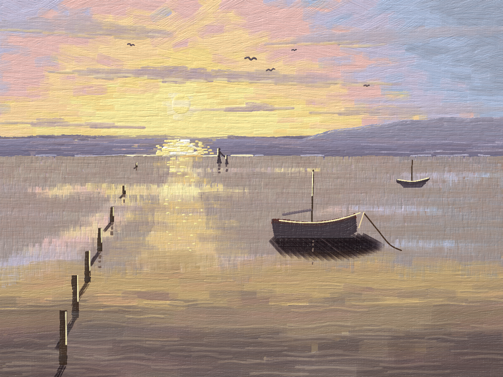
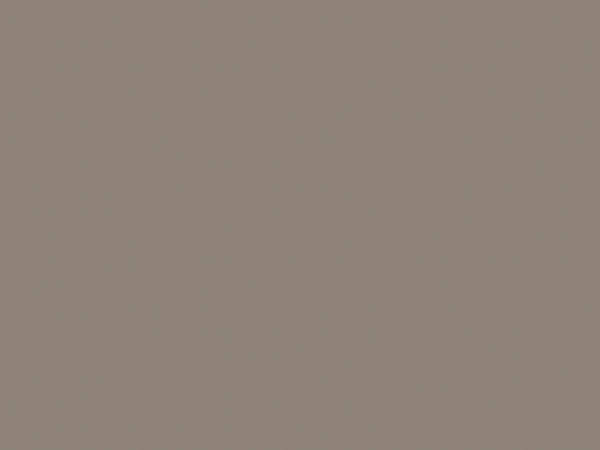

<div align="center">
  <h1>paintscript</h1>
  <p><b>Paint by code: sandboxed JavaScript lays bristle strokes of Kubelka–Munk oil paint, rendered to PNG and timelapse GIF.</b></p>
</div>

<div align="center">

[](./CHANGELOG.md) [](./LICENSE) [](https://www.typescriptlang.org/) [](https://bun.sh/)

</div>

---

A painting is one simulated canvas. You paint it in passages: each passage is a short JavaScript script that mixes paint, loads brushes, and lays strokes, and it runs in a WebAssembly sandbox where it either lands whole or leaves no trace. The scripts are the record. Replaying them on a fresh canvas with the same seed reproduces the painting byte for byte, so every painting can also be filmed as a timelapse GIF.

Colors are 8-band reflectance spectra that mix by Kubelka–Munk, so blue and yellow make green and a glaze tints what is under it. Brushes are bundles of bristles swept along a spline; streaks, dry-brush breaks, ridges, and carried color come out of the sweep. Wet paint mixes with the next stroke, dry paint takes it cleanly, and the surface is lit by its own relief. The script API has no shapes, fills, or gradients, so every form in a painting is a stroke the script author placed. The API is written for language models to paint with, and works the same for a person writing JavaScript.

<p align="center">
  
  
</p>
<p align="center"><i>Low tide</i>: six passages, about 5,400 strokes. <a href="examples/">The scripts</a> and their journal replay it exactly.</p>

## Quick start

Write a passage:

```js
// sky.js
palette('sky', mix(['#2b4f8c', 1], ['#f2efe6', 3]));   // 1 part blue to 3 white
palette('haze', mix(['#f2efe6', 4], ['#c98f5a', 1]));
brush('big', { type: 'flat', width: 48 });

for (let y = 30; y < 300; y += 34)
  stroke({ path: [[-30, y], [600, y + rand(-8, 8)], [1230, y + rand(-5, 5)]], brush: 'big', color: 'sky' });
for (let y = 300; y < 450; y += 30)
  stroke({ path: [[1230, y], [600, y + rand(-6, 6)], [-30, y]], brush: 'big', color: 'haze', load: 0.5 });
dry();
```

and another on top of it:

```js
// field.js
const grass = mix(['#3f6b2a', 3], ['#c9a227', 1]);
for (let i = 0; i < 400; i++) {
  const x = rand(0, 1200), y = rand(470, 900);
  stroke({ path: [[x, y], [x + rand(-6, 6), y - rand(20, 50)]], brush: { type: 'round', width: rand(3, 7) }, color: grass, end: 'flick' });
}
```

Run them in order onto one canvas:

```sh
npx paintscript run sky.js field.js --out painting.png --journal painting.jsonl --timelapse painting.gif --seed 7
```

```
canvas 1200×900, seed 7
sky.js: 13 strokes, 1 dries, 527 ms, 0% wet
field.js: 400 strokes, 0 dries, 104 ms, 6% wet
  · stroke directions across 400 strokes spread 6.0°
wrote painting.png
wrote painting.jsonl
wrote painting.gif (600×450, 151 frames, 10.8 s)
```

The line under `field.js` comes from the run review: the 400 grass strokes have a direction spread (circular standard deviation) of 6°, which is what a mechanical fill looks like. The review states counts and measurements and leaves the fix to the author. `paintscript vocabulary` prints the full script API as TypeScript declarations, written to go in a model's prompt.

## The script vocabulary

Every passage is plain JavaScript (ES2023) with these globals. No imports, timers, I/O, clock, or `Math.random`.

| Global | What it does |
|:---|:---|
| `brush(name, spec)` | Define a named brush: `flat`, `round`, `filbert`, `fan`, `splayed`, `soft`, or `knife`, with width, stiffness, splay, streak, and reservoir |
| `stroke(options)` | Lay one stroke along a path of points (with optional pressure); returns what it covered, missed, mixed, and picked up |
| `mix(...parts)` | Mix paints by parts on the palette: `mix(['#1c3f94', 2], '#f2efe6')` |
| `palette(name, color)` | Name a color for this and later passages |
| `dry(region?)` | Dry the wet paint: its color fixes and its relief stays |
| `at(x, y)` · `wet(x, y)` · `height(x, y)` | Read the canvas: paint color, wet volume, surface height |
| `canvas` | `{ width, height, pxPerMm }` |
| `ref.at(x, y)` · `ref.edge(x, y)` | Sample the reference image: color, and which way its edges run |
| `diff(region?, { cell })` | How far the painting is from the reference, overall and in the worst cells |
| `show(region?, { mode })` | Return a view of the canvas as it is at that line: `color`, `squint`, `value`, `relief`, or `wet` |
| `log(...values)` | Add text to the run's result (`console.log` works too) |
| `rand()` · `noise(x, y)` | Seeded randomness and gradient noise that replay exactly |

Arguments are validated with messages that name the function and field (`stroke(): load must be a number from 0 to 1 (got 1.5)`), and errors point to the line of the script that caused them.

## Library

```ts
import { readFile, writeFile } from 'node:fs/promises';
import { encodePng, formatJournal, journalOf, Painting, renderTimelapse } from 'paintscript';

const painting = await Painting.create({ width: 1200, height: 900, seed: 7 });

const sky = painting.run(await readFile('sky.js', 'utf8'), { label: 'sky' });
if (sky.status !== 'completed') throw new Error(`sky did not land: ${sky.status}`);

// measure a passage without keeping it
const trial = painting.run(await readFile('field.js', 'utf8'), { dryRun: true });
console.log(trial.stats.covered, trial.review, trial.observations);

painting.run(await readFile('field.js', 'utf8'), { label: 'field' });
painting.revert(1); // back to the sky alone

await writeFile('painting.png', encodePng(painting.image()));

const journal = journalOf(painting);
await writeFile('painting.jsonl', formatJournal(journal));
const film = await renderTimelapse(journal, { width: 600 });
await writeFile('painting.gif', film.bytes);
```

| Export | What it does |
|:---|:---|
| `Painting.create(options)` | A blank canvas: size, ground color, texture (`smooth`, `fine_weave`, `coarse_weave`), seed, px per mm, an optional reference image, limits |
| `painting.run(code, options)` | Run one passage; returns its status, stats, review, logs, and views |
| `painting.revert(checkpoint)` | Undo committed runs back to a checkpoint |
| `painting.view(options)` · `painting.image(surface)` | Render a region in any view mode, or the whole lit painting |
| `journalOf` · `formatJournal` · `parseJournal` | The painting's record as JSON Lines |
| `openJournal` · `replayJournal` | A fresh painting from a journal's settings, or with all its runs replayed |
| `renderTimelapse(journal, options)` | Film a journal as a looping GIF |
| `encodePng` · `decodePng` | PNG files to and from `RgbImage` |
| `VOCABULARY_DTS` | The script API as TypeScript declarations, for a model's prompt |

Caller mistakes throw `PaintscriptError` with a stable `code` (`invalid_options`, `invalid_journal`, `reference_mismatch`, `canvas_changed`, …). Script failures never throw; they come back as a run status.

## Runs

A run is atomic. Before a stroke first touches a 64 px tile, the tile is saved; a run that fails, runs out of budget, or is a dry run is restored from those tiles, along with the brushes and palette names it started with.

| Status | Meaning |
|:---|:---|
| `completed` | The passage landed; the checkpoint went up by one (unless it was a dry run) |
| `script_error` | The script threw or failed to parse; `error` has the message, line, and column |
| `budget_exceeded` | The run hit its `time`, `strokes`, or `memory` limit |
| `cancelled` | The caller's `cancelled()` returned true |

The checkpoint is the number of committed runs. Pass `expectCheckpoint` and a run refuses to start (`canvas_changed`) if the painting has moved, so a retried request can't land twice.

| Limit | Default | Per |
|:---|:---|:---|
| `timeMs` | 60,000 | run |
| `strokes` | 250,000 | run |
| `memoryBytes` | 128 MiB | run (script heap) |
| `views` | 4 | run; `show()` calls past it are dropped and counted |
| `logBytes` | 16,384 | run |
| `undoBytes` | 512 MiB | painting; past it, reverts that far back replay the kept scripts instead |

## CLI

| Command | What it does |
|:---|:---|
| `paintscript run <script.js>... --out <png>` | Run each file as one passage, in order, on one canvas. `--journal`, `--timelapse`, `--views <dir>` (save `show()` views as PNG), `--width`, `--height`, `--ground`, `--texture`, `--seed`, `--reference <png>`, `--fit`, `--surface` |
| `paintscript replay <journal.jsonl> --out <png>` | Replay a journal on a fresh canvas. `--timelapse`, `--surface`, and `--reference` for a journal painted against one |
| `paintscript vocabulary` | Print the script API as TypeScript declarations |

Exit codes: `0` done, `1` a passage didn't complete (nothing from it was kept), `2` bad arguments or input.

## Install

```sh
npm install paintscript
# or
bun add paintscript
```

Runs on Node ≥22 and Bun. The sandbox is QuickJS compiled to WebAssembly, so there is no native addon to build.

## Project structure

| Path | Purpose |
|:---|:---|
| `src/color/` | sRGB ↔ 8-band spectra, OKLab, the `Color` values scripts receive |
| `src/paint/` | Kubelka–Munk absorption and scattering per paint kind, mixing, film layering |
| `src/brush/` | Brush and stroke types, path resampling, the bristle kernel |
| `src/canvas/` | Weave, dry base, wet film |
| `src/render/` | Lit render and the view modes |
| `src/script/` | The QuickJS sandbox, the guest prelude, the host vocabulary and its declarations |
| `src/painting/` | `Painting`: runs, tile undo, checkpoints, run review |
| `src/reference/` | Reference images: placement, sampling, edge direction, comparison |
| `src/journal/` · `src/timelapse/` | JSON Lines record and replay; the timelapse GIF |
| `src/image/` | PNG and GIF codecs |
| `src/random/` | The seeded generator every random choice comes from |
| `src/cli/` | The `paintscript` command |
| `docs/design.md` | How the engine works and why it was built that way |

## Development

```sh
bun install
bun run check   # typecheck, Biome with zero warnings, tests, changelog sync
```

- The vocabulary lives in three files that change together: `src/script/prelude.ts`, `src/script/vocabulary.ts`, and `src/script/vocabulary-dts.ts`. A test fails if the declarations and the prelude disagree.
- Everything random is seeded. Engine code never reads the clock or `Math.random`.
- The engine and the vocabulary never gain shapes, fills, gradients, or scatter helpers.

[CLAUDE.md](./CLAUDE.md) has the full working rules; [docs/design.md](./docs/design.md) has the decisions behind the design.

## License

Apache-2.0. See [LICENSE](./LICENSE).
