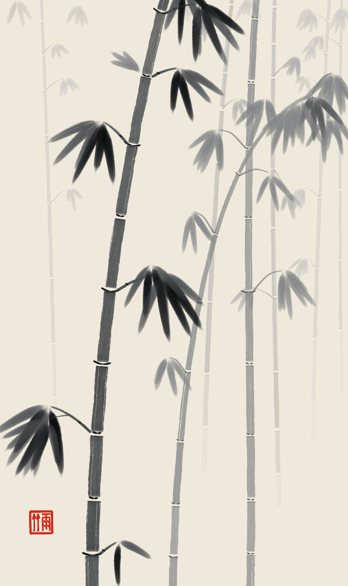
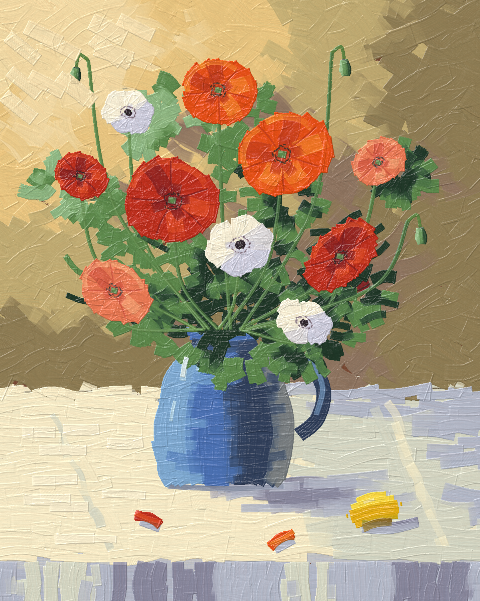

# Examples

Each folder holds the passage scripts for one painting, the finished `painting.png`, the `journal.jsonl` that replays it with `paintscript replay`, and a `timelapse.gif` of it being made. The command under each painting repaints it from the repo root, byte for byte.

## Low tide


A beach at low tide, painted into the setting sun: a row of old posts leads out across wet sand that mirrors the sky, past a beached boat, to a strip of sea where the sun's glitter starts. It is built the way a painter would build it, in six passages: a warm imprimatura and lean block-in, the sky wet into wet in broken color, the headland and sea, the sand (whose reflections sample the painted sky with `at()`), the dark silhouettes with glazed shadows and their rims of light, and last the thick lights, knife sparkle, and gulls. Every color is mixed with `mix()` from seven tubes named in the first passage, and `dry()` sets each layer before the next goes over it.

```sh
bun src/cli/bin.ts run examples/low-tide/0*.js --out examples/low-tide/painting.png --journal examples/low-tide/journal.jsonl --timelapse examples/low-tide/timelapse.gif --seed 1847
```

## Rain bamboo



A grove of bamboo after rain, in ink on paper in the sumi-e tradition: one dark culm in front with its leaves hanging heavy and wet, a middle grove with one culm bowed over, and a far grove fading into mist, signed with a red seal reading 雨竹. It is painted in five passages from the five inks of the tradition (jiao, nong, zhong, dan, qing), mixed once from two soots and water. Each segment of a culm is one flat stroke lifted at the node, and each leaf one round stroke pressed down and lifted to a point. The paint is all transparent: value comes from water, not white, overlapping wet leaves darken where they cross, and the smooth paper takes the dry brush as flying white.

```sh
bun src/cli/bin.ts run examples/bamboo/0*.js --out examples/bamboo/painting.png --journal examples/bamboo/journal.jsonl --timelapse examples/bamboo/timelapse.gif --seed 1127 --width 1100 --height 1850 --ground '#efe9dc' --texture smooth --surface matte
```

## Poppies



A cobalt jug of red, orange, and coral poppies with three white anemones, on a white cloth with a lemon and two fallen petals. It is painted almost entirely with the palette knife, in seven passages: a lean brush drawing and block-in over a warm earth ground, then the wall, the cloth, the jug, the foliage, the poppies, and last the anemones and the thick lights. Each passage lays a course of knife planes and presses a second course into it while wet, so the blade scrapes up the paint underneath and drags it along. Every color is mixed with `mix()` from eight tubes, and `dry()` sets each passage so the next builds relief on top of it. The window light comes from the upper left, the same side as the engine's relief light, so the varnished ridges and the paint piled up where each stroke stops catch the light the painting shows.

```sh
bun src/cli/bin.ts run examples/still-life/0*.js --out examples/still-life/painting.png --journal examples/still-life/journal.jsonl --timelapse examples/still-life/timelapse.gif --seed 2511 --width 1200 --height 1500 --ground '#7d5038' --texture coarse_weave --surface varnish
```
