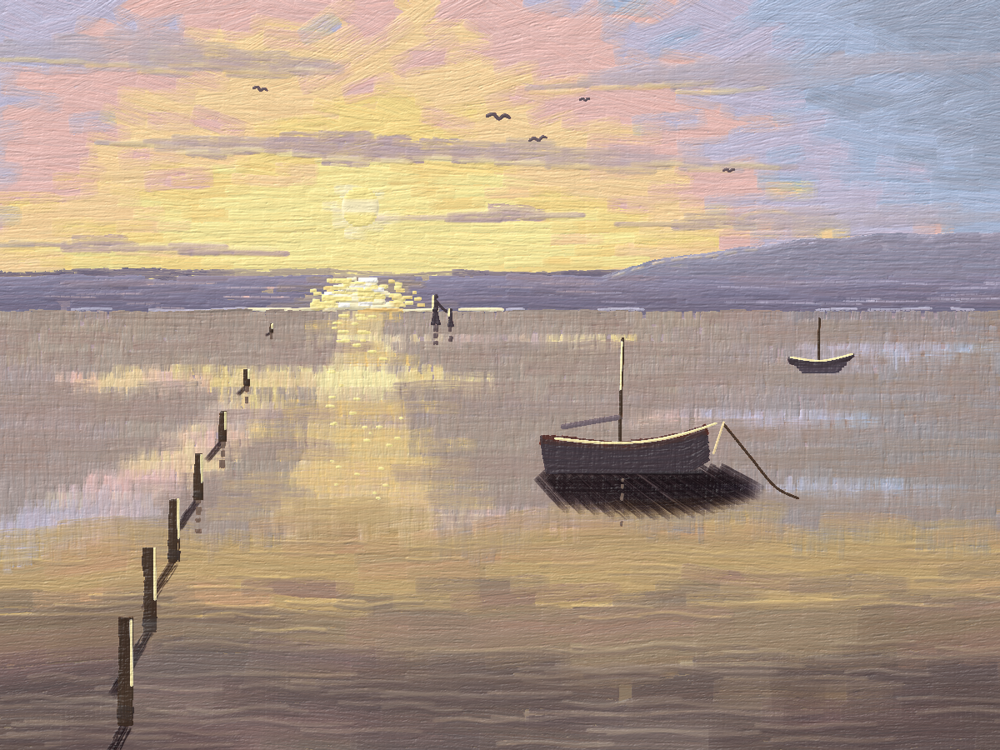

# Examples

## Low tide



A beach at low tide, painted into the setting sun: a row of old posts leads out across wet sand that mirrors the sky, past a beached boat, to a strip of sea where the sun's glitter starts. It is built the way a painter would build it, in six passages: a warm imprimatura and lean block-in, the sky wet into wet in broken color, the headland and sea, the sand (whose reflections sample the painted sky with `at()`), the dark silhouettes with glazed shadows and their rims of light, and last the thick lights, knife sparkle, and gulls. Every color is mixed with `mix()` from seven tubes named in the first passage, and `dry()` sets each layer before the next goes over it.

From the repo root:

```sh
bun src/cli/bin.ts run examples/low-tide/0*.js --out examples/low-tide/painting.png --journal examples/low-tide/journal.jsonl --timelapse examples/low-tide/timelapse.gif --seed 1847
```

[`timelapse.gif`](low-tide/timelapse.gif) shows the painting being made; `journal.jsonl` replays it with `paintscript replay`.
